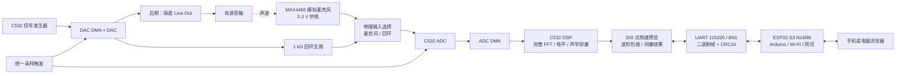
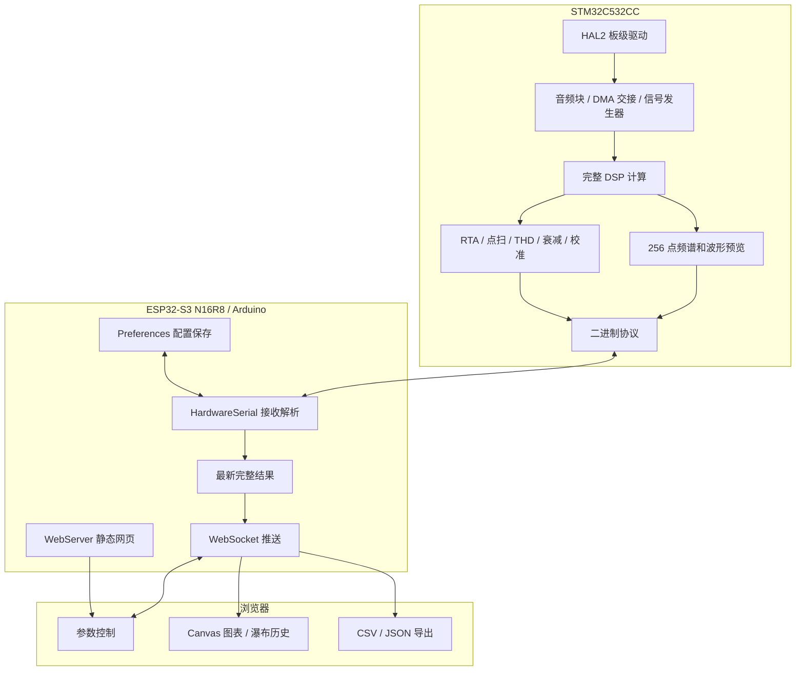

# AcousticLab 声学测量平台完整项目计划

> 版本：修订版 12
> 更新日期：2026-10-05
> 硬件：STM32C532CC + ESP32-S3 N16R8 + MAX4466 模拟麦克风
> 状态：C5 v0.3.0 软件功能、构建及数值/协议测试完成；v0.3实物精度、耗时、校准重复性与长期稳定性待验收。ESP v0.3.0网页/桥接及软件检查也已完成；两板v0.3烧录与联合实物验收待做。

## 1. 项目目标与已确定的方案

### 1.1 项目定位

制作一套个人使用的声学实验平台：C532 采集声音、输出测试信号并完成声学计算；ESP32-S3 提供 Wi-Fi 热点和网页；手机或电脑浏览器显示结果、发送控制命令并导出数据。

前期通过说话、吹口哨、拍手及 DAC→ADC 电气回环完成开发，不需要音箱。以后有有源音箱，再进行声学逐点扫频、频响和失真测量。

本计划合并了两个原始对话，并以用户后续确认的配置为准：

- [STM32C5 声学项目对话](https://chatgpt.com/share/6ab738fe-000c-83ee-a875-0edaabba887e)
- [HAL2 与 ESP32-S3 网页架构对话](https://chatgpt.com/share/6ab73927-0df8-83ee-9126-e7896ee2de5b)

### 1.2 本次修订的决定

| 项目 | 当前确定的方案 |
|---|---|
| C5 外设驱动 | 全部使用 HAL2 |
| C5 算法 | CMSIS-DSP + 自有 C 算法 |
| C5 调度 | 裸机主循环 + DMA 中断 |
| C5 开发工具 | CubeMX2、CMake、GCC、VS Code、ST-Link |
| ESP 硬件 | ESP32-S3 N16R8，16 MB Flash、8 MB OPI PSRAM |
| ESP 开发框架 | Arduino-ESP32 |
| 双板通信 | 3.3 V UART，115200 baud，8N1 |
| 数据包校验 | 保留 CRC16，使用不查表的逐字节累计实现 |
| 网页频谱 | 256 个绘图点，目标每秒更新 10 次 |
| 网页波形 | 64 组 min/max，目标每秒更新 10 次 |
| C5 内部 FFT | 首版 2048 点，后续增加 4096 点；不因网页降点而降低内部计算点数 |
| 网络 | ESP 自建 Wi-Fi 热点 |
| 网页 | 原生 HTML、CSS、JavaScript、Canvas、WebSocket |
| 网页原型 | 独立目录 `acousticlab-preview/`，默认示波器视图，可切换频谱分析 |
| 谐波面板 | 电气回环展示 H1～H5、总 THD、频谱阶次标记和谐波 CSV；实测结果由 C5 提供 |
| 麦克风 | MAX4466 模拟麦克风模块，固定增益 |
| 麦克风输入电阻 | 1 kΩ 不作为必需件，首版默认 OUT 直接接 ADC |
| DAC 回环电阻 | 保留 1 kΩ 串联电阻 |
| 采样与输出 | 单声道、标称 48 kHz、片内 12 位 ADC/DAC |
| 长录音与 IR | 先放入待办，未来倾向电脑离线分析 |

执行进度见 [TODO.md](TODO.md)。本次按用户要求直接推进C5 v0.3.0，包含v0.2固件前置能力。软件完成与硬件验收分开记录，当前需烧录新版并进行基础及高级测量联合实测。

### 1.3 阶段成果

| 版本 | 完成后能做什么 |
|---|---|
| v0.1 | 网页查看波形、频谱、电平和主频，完成 DAC→ADC 回环及麦克风采集 |
| v0.2 | 4096 点 FFT、预览平均、倍频程、相对 A/C/Z 加权电平、瀑布图和完整频谱导出 |
| v0.3 | 正弦逐点扫频、相对幅相、回环校准和 THD |
| v0.4 | 拍手衰减记录、混响时间估算和 SPL 校准入口 |
| v1.0 | 整理操作流程、校准管理、导出格式和完整交付文档 |
| 后续待办 | USB 原始音频、电脑端 ESS/IR、延迟分析和 EQ 建议 |

完整规划全部阶段，但每个阶段都独立可运行、可验收，不等待所有高级功能完成后才交付。

### 1.4 当前实施进度（2026-10-05）

真机网页源码位于 [`esp/videoesp/web/index.html`](esp/videoesp/web/index.html)，随 ESP v0.3.0 固件嵌入，连接热点后通过 `http://192.168.4.1/` 访问；构建和操作见 [ESP 使用说明](esp/videoesp/README.md)。此前已上传v0.1.1；当前v0.3.0软件构建完成但未烧录，交付详情见第13节。以下原型及早期基线记录不代替本版实物验收。

独立高级模拟原型入口为 [`acousticlab-preview/index.html`](acousticlab-preview/index.html)，使用说明见 [`acousticlab-preview/README.md`](acousticlab-preview/README.md)。该原型无需设备；此前视觉检查通过 [`start-preview.cmd`](acousticlab-preview/start-preview.cmd) 启动，以 `http://127.0.0.1:8000/` 访问。下表的模拟界面能力不表示 C5 已实现对应测量。

| 项目 | 当前状态 |
|---|---|
| ESP v0.1.0 真机网页 | 波形、电平、频谱接收入口、启停、暂停/单次、缩放、输入记录、NVS 设置、导出、诊断及重连代码完成，软件检查通过；C5 FFT/DDS 未支持时禁用对应功能 |
| 示波器界面 | 已实现模拟波形、时基、垂直档位、触发设置、AC/DC 耦合、运行/停止、单次采集及 AUTOSET 交互；硬件触发行为待对接 |
| 频谱模式 | 已实现实时频谱、电气回环、逐点扫频和衰减的模拟显示及模式切换；坐标刻度与网格共用映射 |
| 谐波分析面板 | 已实现 H1～H5 频率、dBFS、dBc、幅度比、总 THD、阶次标记、暂停保持和导出 |
| 原型检查 | JavaScript 语法与数据/交互检查已通过；2026-09-27 在 1440×900 和 390×844 浏览器视口完成模拟界面视觉验收，覆盖刻度对齐、H1～H5 标记、表格滚动、按钮布局及四种频谱模式切换，记录见 `TODO.md` |
| 固件与实测 | [C5 独立工程](firmware-c5/generated/README.md)已完成v0.1同步DMA、DDS、FFT/主频/频谱、故障处理及扩展协议，通过Debug/Release编译和C测试；PA0 接地与可调直流输入初测通过。ESP 简易真机页已显示真实 STATUS；用户确认状态查询成功、RTA 切换后出现波形。交流信号、测试音/FFT实物结果、更新率和精度验收待实施 |

独立原型的高级界面不代表 v0.3 测量完成，仍生成模拟数据；ESP v0.1.0 实际网页只接收真实 C5 帧，未支持的频谱/测试音有明确提示。后续主频、谐波幅度与 THD 等测量值必须使用 C5 的结果，不能从 256 点预览反算。

### 1.5 当前固件基线与下一步

配置源为 `firmware-c5/AcousticLab_C5.ioc2`，工程入口为 `firmware-c5/generated/`，自有代码位于其 `app/`。当前按 STM32C532CCT6、LQFP48 配置；USART2 PA2/PA3 排针已通过联调确认，阶段 0 所需硬件与引脚确认按用户本次反馈标记完成。

| 项目 | 已有源码或配置 | 待完成 |
|---|---|---|
| 时钟与触发 | 144 MHz；TIM6 PSC=0、ARR=2999，标称 48 kHz TRGO | 上板确认实际采样率与触发 |
| ADC | PA0 / ADC1_IN0，12 位，LPDMA1_CH0；1024 样本循环缓冲；PA0 直流接地与可调电压输入已按用户反馈通过初步上板检查 | 输入范围、实际采样率、连续性及精度验收 |
| DAC | PA4 / DAC1_OUT1，LPDMA1_CH1；默认中点，32位DDS/Flash插值及10 ms渐变完成 | 交流回环、实际幅度/渐变验收 |
| UART | USART2 PA2 TX、PA3 RX，115200 8N1；TX LPDMA1_CH2，RX 512 字节环形缓冲；ESP GPIO16 RX、GPIO17 TX，已验证状态查询和 RTA 切换 | 长时间收发及坏帧统计 |
| 电平 | 每512样本处理，约2 Hz去直流、RMS/峰值/削顶/丢块；数字RMS精度测试通过 | 上板测量 |
| 状态 | IDLE/RTA块边界切换，测试音独立控制；2048点FFT/256点预览、故障停输出及看门狗完成 | 实物生效状态、耗时与故障验收；高级测量后续实现 |
| 网络 | ESP v0.1.0 完整网页/桥接已构建，包含波形、频谱入口、电平、暂停/单次、设置、导出与诊断；协议和浏览器检查通过。此前最小固件已实测 | 新版烧录、NVS 断电保存、真机重连和长期运行；C5 FFT/DDS 联调 |

当前协议详见 [PROTOCOL.md](firmware-c5/generated/PROTOCOL.md)：已实现STATUS、COMMAND、REPLY、LEVEL、WAVEFORM和SPECTRUM_PREVIEW。STATUS为40字节、1 Hz，fft_length=2048；LEVEL/波形/频谱目标各10 Hz，主频按真实有效标志显示。COMMAND 3控制20～20000 Hz、−40～−6 dBFS峰值测试音；REPLY表示接受，后续STATUS确认提交。

C5 v0.1.0 Release Flash=59320 B、SRAM占用/预留=45192 B（含4 KiB栈、512 B堆）；Debug Flash=87072 B。worst_block_us改用TIM2 1 MHz时基；<8 ms目标必须在Release实物运行测量，尚未验收。

已在本机编译波形链路并提供 [串口上位机](upper_pc/README.md)。2026-09-27 用户反馈 PA0 经面包板引出后的接地及可调直流输入测试正常：有确定电位时波形随电压移动，悬空时受环境和人体耦合影响明显；具体电压、原始 ADC 码值和测量仪表读数尚未记录。此前用户提供的 STATUS 串口帧经协议解析与 CRC 核对，48 kHz、块数与采样序号一致，丢块和 DAC 错误为 0；三帧中的接收坏帧计数均为 25。随后 ESP 工程已通过 COM8 烧录，手机经 ESP 热点打开简易真机页；用户确认状态查询成功，开始分析后模式变为 RTA 并出现波形。联调期间多接了一根两板 3V3 之间的蓝线，拔掉后命令恢复；现保持两板分别 USB 供电、共地和两根交叉 UART 线。DDS/FFT已在本次完成软件实现；下一步烧录并量化LEVEL/WAVEFORM/SPECTRUM更新率与链路稳定性。阶段 0 已于 2026-10-01 根据用户确认标记完成，包含最小链路与启停命令验证；v0.1 尚未验收完成。以上为此前实物联调记录；本次 ESP 软件检查单列于 1.6，不补写未提供的硬件测量数值。

### 1.6 ESP v0.1.0 软件完成记录（2026-10-01）

完整工作台已放入 `esp/videoesp/web/`，构建时嵌入固件。包含显示控制、输入备注、诊断、显式配置保存、CSV/JSON 快照导出、重连和重启处理；时基/AC/SINGLE 仅操作显示，不宣称硬件触发。兼容旧 C5 32 字节及 v0.1.0 的 40 字节 STATUS，已支持频谱接收和测试音扩展，见 [ESP 协议](esp/videoesp/PROTOCOL.md)。按 C5 实际能力标志启用。

Release 构建成功、无警告：静态 RAM 51,376 B / 327,680 B（15.7%），应用 Flash 782,833 B / 6,553,600 B（11.9%）。14 项协议检查及 15 类浏览器场景通过，覆盖 CRC/截断、启停、暂停/单次、频谱、测试音入口、保存/重载、导出、超时、重连、重启、手机布局和能力缺失；浏览器错误 0。测试数据为独立 test/tools 的夹具，未进入固件。

本次电脑未检测到 COM8，因此新版尚未烧录。NVS 真实断电保存、UART 更新率、热点性能和 30 分钟稳定性待上板；C5 DDS/FFT软件已完成，实物测量精度仍待验收。详见 [使用说明](esp/videoesp/README.md)与[验证记录](esp/videoesp/VALIDATION.md)。系统 v0.1 验收维持未完成。

发布文件位于 [`esp/videoesp/release/v0.1.0/`](esp/videoesp/release/v0.1.0/README.md)，包含应用镜像、ELF、引导程序、分区、含验证截图的源码压缩包及 SHA256 清单。四份内置网页 gzip 资产与源码逐字节一致，发布文件和源码归档哈希已核对。使用 PlatformIO Upload 烧录；应用 `firmware.bin` 不是地址 0 的完整 Flash 镜像。

当前待完成顺序：烧录新版 ESP 并验证完整网页/启停；验证 NVS 断电恢复及真实重连/复位；烧录已完成的C5 DDS/FFT/扩展协议固件；完成交流回环、麦克风、精度、10 Hz 更新率及 30 分钟稳定性验收。具体执行项见 TODO 第 4 节。

### 1.7 C5 v0.1.0 软件完成记录（2026-10-01）

C5 当前阶段完整软件已实现：独立测试音DDS、2048点周期Hann/50%重叠FFT、完整谱主频、256点预览、微秒计时、DMA快照与输出补区检查、故障停止及IWDG恢复。自写源码全部在 `firmware-c5/generated/app`，入口与注释为中文；源码不包含模拟测量夹具。Measurement/Calibration按后续阶段实际功能新增。

Debug/Release CLI重新生成和编译均通过、无警告；7项同源C算法及主循环测试通过。60秒虚拟串口测试中LEVEL/WAVEFORM/SPECTRUM各599帧，总流量8580.4 B/s；RMS/FFT归一化、DC、窗口步长、Nyquist、DDS渐变、命令应答、故障停机均通过软件检查。旧Windows工具已兼容扩展STATUS。

交付 [C5 v0.1.0 Release](firmware-c5/generated/release/v0.1.0/README.md) 包含HEX/BIN/ELF/MAP及SHA256；具体步骤和待测表见 [C5验证记录](firmware-c5/generated/VALIDATION.md)。本次未烧录，不勾选交流回环、麦克风、真实10 Hz、<8 ms或30分钟稳定性；系统v0.1仍待联合实物验收。

当前基线：C5 与 ESP v0.1.0 的软件均已交付。先烧录两板新版，查询确认 C5 为 IDLE、48 kHz、FFT=2048、测试音关闭；再做 PA4 经 1 kΩ 到 PA0 的 1 kHz 回环、−12→−18 dBFS 电平差、麦克风输入、真实预览速率及 30 分钟运行。实测记录填写到 C5 VALIDATION 后同步 TODO，未提供的测试结果保持待办。

### 1.7 ESP v0.1.1 刷新修复（2026-10-01）

用户确认 v0.1.0 已烧录，并反馈刷新后卡住、随后连接失败。截图已有 C5 STATUS 字段，ESP 周期诊断为“—”；因此不能认定 UART 始终零接收。修复 HTTP 整块同步写入及 WebSocket 单槽刷新交接路径，减少回调栈占用，新增独立 HTTP 诊断与首连立即诊断。详见 [版本说明](esp/videoesp/CHANGELOG.md)。没有卡死时的异常日志，唯一根因尚未证明。

v0.1.1 已 Release 编译并通过 COM8 烧录，写入哈希校验通过；串口确认版本、16 MB Flash、8,385,943 B PSRAM、启动循环栈余量 5,328 B。14 项协议检查、15 类浏览器场景及额外 6 次连续刷新通过，浏览器错误 0（本地夹具）。手机真热点刷新、UART 实测计数、NVS 及长期运行仍保留待办，不据软件测试标为硬件验收通过。

## 2. 编程原则：直接实现，不做过度防御

1. C5 使用固定配置、静态数组和明确的模块接口，运行期间不动态分配内存。
2. 内部函数按约定调用，不逐层重复检查空指针、参数范围和数组长度。
3. 通信入口检查帧长度、CRC 和外部命令参数一次；业务模块直接使用解析结果。
4. 初始化失败报告具体外设并停止启动，不增加自动重试、降级链或复杂恢复框架。
5. 实时显示数据采用最新值；过期预览允许丢弃，不堆积、不重传。
6. 只记录与测量有关的问题：采样丢块、DAC 欠载、通信坏帧和输入削顶。
7. 测量数据不足就显示“数据不足”，不凭空生成测量值，也不为此搭建复杂评分系统。
8. 不增加通用插件系统、事件总线、动态后端切换或多层驱动封装。
9. 自有外设代码不调用 LL、不直接写外设寄存器；HAL2 内部实现保持官方版本。
10. ESP 使用 Arduino 的 `setup()` / `loop()` 组织应用，首版不自行建立 FreeRTOS 任务体系。
11. 优先优化数据量、算法和缓冲使用，不提前优化不存在的瓶颈。

保留 CRC、DMA 缓冲交接及必要的测量有效性判断，属于具体功能要求，不扩展成多层防御性编程。

## 3. 硬件架构

### 3.1 系统框图



### 3.2 C532 资源分配

C532CC 具有 144 MHz Cortex-M33、单精度 FPU、DSP 指令、256 KB 程序 Flash、64 KB SRAM，以及片内 ADC、DAC 和 DMA。这里的 64 KB 是 C5 自己的 RAM，与 ESP 的 8 MB PSRAM 分属两个处理器。[ST 产品资料](https://www.st.com/en/microcontrollers-microprocessors/stm32c532cc.html)

| 资源 | 用途 |
|---|---|
| ADC 一路 | 采集麦克风或 DAC 回环信号 |
| DAC 一路 | 输出正弦及后续扫频信号 |
| 定时器 | 产生统一采样节拍 |
| ADC DMA | 连续接收采样数据 |
| DAC DMA | 连续输出测试信号 |
| UART TX DMA | 发送结果，不阻塞采样计算 |
| UART RX | 接收少量控制命令 |
| FPU / DSP | FFT、电平、同步检波及衰减计算 |
| OPAMP | 首版不启用，MAX4466 已提供前置放大 |
| CORDIC | 暂不启用，有实测计算瓶颈时再评估 |
| USB | 当前不作为业务链路，保留给后期原始音频扩展 |

### 3.3 ESP32-S3 N16R8

| 资源 | 规格 | 当前用途 |
|---|---|---|
| Flash | 16 MB，Quad SPI | 固件、网页资源和配置 |
| PSRAM | 8 MB，Octal SPI | 启用并保留，后续按需用于较大的结果缓存 |
| 片内 RAM | 由 Arduino 和网络栈共同使用 | UART 接收、最新帧和网络运行 |

N16R8 的容量及接口模式依据乐鑫对应模块规格。[官方数据手册](https://www.espressif.com/sites/default/files/documentation/esp32-s3-wroom-1_wroom-1u_datasheet_en.pdf)

首版不为使用 PSRAM 而增加大缓存。瀑布图历史继续保存在浏览器；ESP 只保留最新结果和正在接收的导出数据。启用 PSRAM 不代表普通静态变量自动进入外部内存。

**ESP 的大内存不会增加 C5 的 SRAM，也不会提高 115200 串口的吞吐量。**

N16R8 表示内存配置，不能单凭该名称确定开发板排针布局。当前实物照片与通信测试已核对使用的 GPIO16/17；其他 GPIO 占用仍需按实际板型核对。

### 3.4 首批硬件

| 物料 | 数量 | 用途 |
|---|---:|---|
| STM32C532CC 开发板 | 1 | 采样与运算，已有 |
| ESP32-S3 N16R8 开发板 | 1 | 网络与网页，已有 |
| MAX4466 模拟麦克风模块 | 1 | 固定增益音频输入 |
| ST-Link | 1 | C5 下载调试；有板载调试器时无需另配 |
| USB 数据线 | 按板卡需要 | 供电与下载 |
| 面包板、杜邦线 | 1 套 | 原型连接 |
| 1 kΩ 电阻 | 数个 | DAC→ADC 回环；麦克风支路不强制使用 |
| 100 nF、10 µF 电容 | 各数个 | 麦克风电源去耦 |
| 万用表 | 1 | 测量电源和输入偏置 |
| 跳线座或手动换线 | 1 组 | 选择麦克风或回环输入 |

首版不采购音箱、功放、屏幕、SD 卡或外置音频 Codec。

### 3.5 接线表

| 来源 | 目标 | 说明 |
|---|---|---|
| C5 3.3 V | MAX4466 VCC | 固定使用 3.3 V 供电 |
| C5 GND | MAX4466 GND | 共地 |
| MAX4466 OUT | 输入选择端 MIC | 默认直接连接，不要求串联 1 kΩ |
| C5 DAC_OUT | 1 kΩ → 输入选择端 LOOP | 电气回环 |
| 输入选择公共端 | C5 ADC_IN | 两种信号只接一种 |
| C5 UART_TX | ESP UART_RX | 3.3 V 逻辑 |
| ESP UART_TX | C5 UART_RX | 3.3 V 逻辑 |
| C5 GND | ESP GND | 双板共地 |

两块板分别通过自己的 USB 接口供电，只连接信号地，不并联两块板的 3.3 V 输出。麦克风靠近 C5，模拟线远离 ESP 天线。

输入选择采用物理跳线。网页记录当前接法，不提供没有硬件支持的“自动切换输入”功能。

### 3.6 关于麦克风输入的 1 kΩ

信号路径是：

```text
MAX4466 OUT → C5 ADC → DMA → DSP 软件计算
```

MAX4466 使用 3.3 V 供电、与 C5 共地，且输出在 ADC 允许范围内时，可以直接连接 ADC。模块示例也采用 OUT 直接接模拟输入的方式，静态输出偏置约为 VCC/2。[模块接线说明](https://learn.adafruit.com/adafruit-microphone-amplifier-breakout?view=all)

串联 1 kΩ 是可选的限流、隔离元件，不是 DSP 必需条件，不提供增益，也不能单独构成完整抗混叠滤波器。本计划默认省略麦克风支路电阻，保留 DAC 回环支路电阻。

前端使用固定增益模块，不使用 AGC。电位器可以在测量前调整，测量过程中不改变增益。

首版没有完整的陡峭抗混叠滤波器，因此 20 kHz 是展示和实验范围，不代表整个频段已具有平坦、校准过的测量精度。ADC 采样时间根据前端源阻抗配置，不一味使用最短采样时间。

### 3.7 后期 Line Out

有有源音箱后增加：

```text
DAC_OUT → 1 kΩ → 10 µF 隔直电容 → Line Out
                                  │
                              100 kΩ 到 GND
```

- 接入高阻抗线路输入，目标输入阻抗不低于 10 kΩ。
- 电解电容正端朝 DAC 偏置侧。
- 使用单声道输出，不短接左右声道端子。
- DAC 不直接驱动裸扬声器或低阻抗耳机。
- 增加 Line Out 后，重新测量经过该路径的回环响应。

### 3.8 时钟与采样触发

- ADC、DAC 均固定为标称 48 ksample/s。
- 优先选用两者共同支持的同一定时器触发源，由 CubeMX2 和对应芯片文档确认。
- 首版使用内部时钟，记录实际时钟树及定时器分频。
- 首版关闭 ADC 硬件过采样，先建立明确的 12 位采样基线。
- 12 位 ADC 数据用 `uint16_t` 保存，不描述为 16 位 ADC 精度。

启动顺序：配置外设 → ADC 硬件校准 → 预填 DAC 缓冲 → 就绪 ADC/DAC DMA → 最后启动采样定时器。

共用触发建立固定时间关系，但 ADC 采样与 DAC 模拟输出之间仍可能有固定延迟，后续通过回环记录。共用时钟的回环不能证明时钟绝对准确，需要绝对频率时再用独立参考测量采样率。

## 4. 软件架构与开发环境

### 4.1 分工框图



ESP 和浏览器不重新计算声学结果。浏览器仅完成坐标转换、绘制、历史排列和文件导出；主频、幅相、THD、倍频程等数值由 C5 给出。

### 4.2 C5 开发基线

- STM32CubeC5 2.1.0。
- 配套 HAL2 2.1.0。
- 软件包配套 CMSIS-DSP 1.17.0。
- CubeMX2 生成 CMake 工程，VS Code 配合 ST 工具链下载调试。
- Cortex-M33 单精度硬浮点配置；应用和 CMSIS-DSP 使用一致的 ABI。
- 性能测试使用优化构建，不能用未优化调试构建判断实时能力。

组件配套版本依据 [STM32CubeC5 版本清单](https://github.com/STMicroelectronics/STM32CubeC5/blob/main/Release_Notes.md)。VS Code 的 CMake 工程生成方式见 [CubeMX2 官方说明](https://dev.st.com/stm32cube-docs/stm32cubemx2/1.0.0/en/docs/markup/CubeMX2_UserManual/CubeMX2_UserManual_IDE_ProjectGen.html)。

### 4.3 ESP Arduino 基线

当前 ESP v0.1.0 工程位于 `esp/videoesp/`，使用 PlatformIO + Arduino-ESP32；固定 Espressif32 7.0.1、WebSockets 2.7.2、ArduinoJson 6.21.5，Arduino-ESP32 为 2.0.17。入口 `src/main.cpp`，网页在 `web/`，构建脚本自动 gzip 嵌入 Flash，无需文件系统上传。使用 `-Wall -Wextra -Werror` 检查用户源码。

| 功能 | 使用组件 |
|---|---|
| 双板串口 | Arduino `HardwareSerial`，使用独立硬件 UART |
| Wi-Fi 热点 | `WiFi.h` |
| 静态页面 | Arduino core 自带 `WebServer.h` |
| WebSocket | Links2004 `arduinoWebSockets` 的 `WebSocketsServer` |
| 配置持久化 | `Preferences.h`，显式保存整组配置，未变化不写 Flash，启动不自动执行测量 |
| 程序结构 | `setup()` 初始化，`loop()` 轮询 |

Arduino 官方提供硬件串口和热点能力；所选 WebSocket 库支持 ESP32 及二进制帧。[串口文档](https://docs.espressif.com/projects/arduino-esp32/en/latest/api/serial.html)、[Wi-Fi 文档](https://docs.espressif.com/projects/arduino-esp32/en/latest/api/wifi.html)、[WebSocket 库](https://github.com/Links2004/arduinoWebSockets)

Arduino 设置：

| 设置 | 取值 |
|---|---|
| Board | 当前 PlatformIO 使用 `boards/acousticlab_esp32s3_n16r8.json` 自定义板型 |
| Flash Size | 16MB |
| Flash Mode | 对应 N16R8 WROOM-1 的 Quad Flash 使用 QIO |
| PSRAM | OPI PSRAM |
| CPU / Flash Frequency | 保持匹配板型的默认配置 |
| 分区 | 使用 16 MB 对应布局；首版页面随固件编译，不引入文件系统依赖 |
| C5 通信波特率 | 115200，`SERIAL_8N1` |

OPI 是 PSRAM 的接口模式，不据此把 Quad Flash 也设置为 OPI。Arduino 的“Upload Speed”是烧录速度，与 C5↔ESP 的运行串口波特率是两个配置。[Arduino 工具菜单说明](https://docs.espressif.com/projects/arduino-esp32/en/latest/guides/tools_menu.html)

### 4.4 工程组织

| 区域 | 内容 |
|---|---|
| C5 固件 | 官方生成代码、板级驱动、音频、DSP、测量、协议 |
| ESP Arduino 工程 | 串口桥接、热点、HTTP/WebSocket、配置 |
| 网页资源 | HTML、CSS、JavaScript、Canvas 绘图 |
| 共享协议 | 消息编号、字段、单位和示例帧 |
| 文档与参考工具 | 接线、校准、算法参考计算和验收记录 |

官方生成代码与自有模块分开管理，不把全部逻辑塞入 C5 的 `main()` 或 Arduino 的 `loop()`。

## 5. C5 实时调度与资源预算

### 5.1 音频缓冲

- ADC DMA：`uint16_t[1024]`，两半各 512 点。
- DAC DMA：`uint16_t[1024]`，两半各 512 点。
- 一个半区对应 `512 / 48000 = 10.667 ms`。
- ISR 记录完成半区和递增块序号；主循环读取输入或填充输出。
- 不只用一个布尔标志表示数据到达，避免无法辨认已经丢过一个块。
- 多字段交接使用短临界区；ISR 不执行 FFT、不打印、不等待串口。
- 发送缓冲在 UART DMA 完成前保持不变。

主循环优先顺序：

```text
处理到期的 ADC/DAC 半区
    ↓
更新电平和当前测量
    ↓
到达窗口步长时执行 FFT
    ↓
解析控制命令
    ↓
UART 空闲时安排下一帧
```

最重处理路径目标小于 8 ms，给 10.667 ms 的缓冲期限留下余量；最终以板上实测为准。

采样丢块时，RTA 重新收集连续窗口；点扫和衰减测量终止当前结果并报告一次原因。显示帧丢弃与采样丢块分别计数。

### 5.2 模块与状态

| 模块 | 对外职责 |
|---|---|
| Board | 提供实际引脚、外设和时钟映射 |
| Audio | 启停、输入块、样本编号及缓冲交接 |
| Generator | 设置波形参数，填充 DAC 空闲半区 |
| DSP | RMS、FFT、功率、主频和预览整理 |
| Measurement | 启动、推进和取消当前测量 |
| Calibration | 应用电平偏移和指定路径的频响修正 |
| Protocol | 命令解码、结果编码和 UART DMA 发送 |

音频块包含样本指针、样本数、首样本编号；采样率属于会话配置，不在每层重复检查。

```text
BOOT → IDLE
         ├─ RTA
         ├─ STEP_SWEEP
         ├─ THD
         ├─ DECAY
         └─ CALIBRATION
```

正弦输出是独立开关，可与 RTA 同时工作。停止全部测量时将输出交流分量降为零，DAC 回到中点。

FFT 长度和模式在块边界切换，清空上一模式的窗口与累计量。

### 5.3 HAL2 实现要求

按照 HAL2 的初始化、配置、DMA 关联和启动顺序实现，不复制 HAL1 函数签名。

尤其注意：HAL2 ADC/DAC DMA 接口中的 `size_byte` 是字节数。1024 个 `uint16_t` 样本对应 2048 字节。[HAL2 ADC 接口](https://dev.st.com/stm32cube-docs/stm32c5xx-hal-drivers/2.1.0/en/docs/drivers/hal_drivers/adc/api/hal_adc_exported_functions.html)

### 5.4 SRAM 预算

按支持 4096 点 FFT 的固件规划，常量表放 Flash：

| 用途 | 预算 |
|---|---:|
| ADC DMA | 2 KiB |
| DAC DMA | 2 KiB |
| 4096 点样本环形缓冲 | 8 KiB |
| FFT 输入、输出工作区 | 32 KiB |
| UART TX 单缓冲 | 1 KiB |
| UART RX | 0.5 KiB |
| 256 点预览功率平均状态 | 1 KiB |
| 当前路径的校准表 | 1.5 KiB |
| 句柄、滤波状态和其他小型数据 | 2 KiB |
| 栈 | 4 KiB |
| **合计目标** | **54 KiB** |
| **预留** | **10 KiB** |

落实方式：

- 样本环形缓冲保存有符号 ADC 码，保留原始 12 位采样信息，FFT 时再转换为浮点。
- 不增加完整浮点幅度数组；FFT 完成后复用工作区生成幅度及预览。
- 频谱平均只为 256 个绘图区间保留状态，不额外保存 2049 个浮点历史值。
- 衰减测量与实时 FFT 互斥，共用 32 KiB 工作区。
- 大结果分块发送，不为完整频谱或衰减曲线额外分配大包。
- 只在 RAM 中加载当前测量路径的校准表；其他表存 ESP Flash。
- 最终依据 map 文件及栈使用实测验收，不把预算当成已测结果。

相较原计划 4.25 KiB 的发送缓冲，1 KiB 发送缓冲减少 **3.25 KiB**。这远大于删除 CRC 能节约的几个字节。程序 Flash 目标不超过 224 KiB。

## 6. DSP、预览与信号发生器

### 6.1 处理链路

```text
ADC 原始码 → 有符号样本
                ├─ 2 Hz 直流阻断 → RMS / Peak
                ├─ 原始削顶统计
                ├─ 波形 min/max
                └─ 整窗去均值 → Hann 窗 → 完整 RFFT
                                            ├─ 主频 / 功率 / 声学测量
                                            ├─ 256 点绘图预览
                                            └─ 按需完整频谱快照
```

FFT 对整窗去均值；流式电平使用一阶直流阻断，二者各自维护明确的数据路径。去直流不能恢复模拟端已经削顶的信号。

### 6.2 电平定义

以 ADC 半量程归一化：

\[
x[n]=\frac{raw[n]-2048}{2048}
\]

流式电平在去直流后计算：

\[
RMS=\sqrt{\frac{1}{N}\sum x[n]^2},\qquad
L_{RMS}=20\log_{10}(RMS)
\]

本项目使用归一化幅度 1 对应 0 dBFS 的约定。满幅正弦峰值为 0 dBFS，RMS 约为 −3.01 dBFS。

零输入显示下限为 −120 dBFS，这只是显示下限，不是硬件实际动态范围。未经声学校准不显示绝对 dB SPL。

### 6.3 FFT 参数

| 参数 | 2048 点 | 4096 点 |
|---|---:|---:|
| 采样率 | 48 kHz | 48 kHz |
| 窗口时长 | 42.67 ms | 85.33 ms |
| bin 间隔 | 23.4375 Hz | 11.71875 Hz |
| 窗函数 | Hann | Hann |
| 重叠率 | 50% | 50% |
| C5 计算更新率 | 约 46.875 次/s | 约 23.438 次/s |
| 网页预览上限 | 10 次/s | 10 次/s |

使用 CMSIS-DSP 的实数 FFT，正确处理打包结果中的 DC 和 Nyquist；输入缓冲可能被变换修改。[RFFT 文档](https://arm-software.github.io/CMSIS-DSP/main/group__RealFFTF32.html)、[打包排列](https://arm-software.github.io/CMSIS-DSP/v1.14.2/group__RealFFT.html)

幅度和功率分别使用正确的窗归一化：

\[
A[k]=\frac{2|X[k]|}{\sum w[n]}
\]

\[
P[k]=\frac{c_k|X[k]|^2}{N\sum w[n]^2}
\]

幅度式适用于普通正频率点，DC、Nyquist 单独处理；功率式中普通正频率点 `c_k=2`，DC、Nyquist 为 1。

主频从完整 FFT 查找，可做相邻三点插值。插值改善纯音估计，不代表能分开原本落在同一频率分辨范围的多个声源。

### 6.4 256 点频谱预览

256 是网页绘图点数，不是 FFT 长度。完整主频、倍频程、THD 和校准计算在降点前完成。

首版使用固定、可由浏览器重建的频点分组：设 `K=N/2`，不发送 DC。

1. 前 128 个绘图点分别对应 FFT bin 1～128，保留低频原始分辨率。
2. bin 129～K 均匀划分为剩余 128 个连续区间。
3. 每个区间取幅度最大值，形成峰值包络，避免简单抽点漏掉窄峰。
4. 浏览器用单 bin 频率或区间中心频率绘制，横轴为对数频率。
5. 主频数值单独上传，来自完整 FFT，不从粗化曲线反推。

后 128 个区间由以下规则确定，`j=0..127`：

```text
start_bin = 129 + floor(j * (K - 128) / 128)
end_bin   = 128 + floor((j + 1) * (K - 128) / 128)
```

预览采用 `int16_t`，单位 0.01 dB，256 点共 512 字节。默认显示 20 Hz～20 kHz；包内映射可覆盖至 Nyquist。

预览是绘图包络，不能当成等带宽功率谱积分。v0.2 的频谱平均在这 256 个区间的线性功率域执行，默认时间常数 0.3 秒；测量模块仍使用完整数据。

### 6.5 波形预览

- 每次选择最新完成的一个 512 点音频块。
- 每 8 个样本取一组 min/max，共 64 组。
- 上传 128 个 `int16_t`，数据体为 256 字节。
- 目标每秒更新 10 次，浏览器绘制 min/max 包络。
- 界面注明该窗口约 10.667 ms；它不是连续录音，也不能用于恢复原始 PCM。

### 6.6 正弦发生器

- 32 位 DDS 相位累加器。
- Flash 保存 1024 点正弦表，使用线性插值。
- 按 DMA 空闲半区填充，不逐采样点调用 HAL 输出。
- DAC 中点为 2048。
- 默认 1 kHz、−12 dBFS 峰值。
- 首版允许 20 Hz～20 kHz、−40～−6 dBFS 峰值。
- 启停应用约 10 ms 幅度渐变。

48 kHz DAC 的高频输出有实际幅度和波形限制，通过回环记录响应，不将采样率直接等同于平坦输出带宽。

## 7. UART 协议与 115200 带宽

### 7.1 帧格式

使用小端二进制协议，8N1 不启用 UART 硬件奇偶校验；数据包末尾保留 CRC16。

```text
MAGIC | VERSION | TYPE | SEQ | LENGTH | SAMPLE_INDEX | PAYLOAD | CRC16
```

| 字段 | 大小 | 定义 |
|---|---:|---|
| MAGIC | 2 字节 | 固定字节 A5 5A |
| VERSION | 1 字节 | 初版为 1 |
| TYPE | 1 字节 | 消息类型 |
| SEQ | 2 字节 | 帧序号，按无符号回绕处理 |
| LENGTH | 2 字节 | 负载字节数 |
| SAMPLE_INDEX | 4 字节 | 当前会话的采样位置，按无符号回绕处理 |
| PAYLOAD | 可变 | 消息内容 |
| CRC16 | 2 字节 | CRC-16/CCITT-FALSE，小端保存 |

固定开销共 14 字节。CRC 覆盖 VERSION 至 PAYLOAD，参数为 `poly=0x1021, init=0xFFFF, refin=false, refout=false, xorout=0`。

按字段编码，不直接发送存在对齐填充的 C 结构体。浮点数使用双方约定的 IEEE-754 binary32 小端格式。

### 7.2 校验与缓冲

- CRC 使用不查表实现，边接收边累计，不复制整帧。
- CRC 的核心累计状态为一个 `uint16_t`；每帧只增加 2 字节。
- 删除 CRC 不会自动缩小已经定义的收发数组，因此不以删除 CRC 作为省内存手段。
- 结果负载上限 1000 字节，完整帧放入 1024 字节 TX 缓冲。
- C5 命令负载上限 128 字节，RX 缓冲为 512 字节。
- ESP 串口驱动 RX 环形缓冲先设 4096 字节，在串口初始化前设置。
- 不合法长度或坏 CRC 的帧直接丢弃并重新找帧头，不增加纠错与重传。

### 7.3 消息及最小数据约定

| 消息 | 方向 | 内容 |
|---|---|---|
| STATUS | C5→ESP | 运行模式、时钟/采样配置、校准状态和计数 |
| LEVEL | C5→ESP | RMS、Peak、主频、削顶及运行统计 |
| SPECTRUM_PREVIEW | C5→ESP | Fs、N、点数和 256 个幅度值 |
| WAVEFORM | C5→ESP | 原窗口样本数、组数和 64 组 min/max |
| MEASUREMENT | C5→ESP | 单个点扫结果、THD 或测量摘要 |
| DATA_CHUNK | C5→ESP | 完整频谱、衰减曲线等分块数据 |
| COMMAND | ESP→C5 | 启停、模式、输出参数、快照和校准命令 |
| REPLY | C5→ESP | 对应命令序号及执行结果 |

频谱预览负载：`Fs:uint32 + N:uint16 + count:uint16 + levels:int16[256]`，共 520 字节，整帧 534 字节。

波形负载：`source_count:uint16 + group_count:uint16 + minmax:int16[128]`，共 260 字节，整帧 274 字节。

LEVEL 负载预算 32 字节：3 个 `float32` 表示 RMS dBFS、Peak dBFS、主频 Hz；5 个 `uint32` 表示削顶样本数、状态标志、采样丢块数、最重块处理时间和运行时间。STATUS 负载不超过 64 字节。

### 7.4 带宽预算

115200、8N1 每字节在线路上占 10 bit：

\[
115200 / 10 = 11520\ \text{字节/秒}
\]

| 数据 | 频率 | 整帧大小 | 带宽 |
|---|---:|---:|---:|
| 256 点频谱预览 | 10 次/s | 534 B | 5340 B/s |
| 64 组波形 min/max | 10 次/s | 274 B | 2740 B/s |
| LEVEL | 10 次/s | 46 B | 460 B/s |
| STATUS | 1 次/s | 最多 78 B | 最多 78 B/s |
| **合计** | | | **最多约 8618 B/s** |

常态占理论容量约 75%，给回复和少量其他数据保留余量。控制上传总量目标不超过 9 KB/s。每帧 CRC 的开销已经包含在上表中。

100 ms 内依次发送频谱、波形和电平，约需 74 ms 线路时间；每种类型最多保留一份待发送的最新值。

不在该链路连续传送 48 kHz、16 位单声道原始音频，它需要 96 KB/s。串口波特率降低不改变 C5 的 48 kHz 采样率和完整 DSP 计算。

### 7.5 完整数据按需导出

完整频谱仍支持导出，不把 256 点预览冒充全部频点。

1. 用户发出快照命令。
2. C5 在完成一个 FFT 后冻结该结果工作区。
3. 暂停常规预览上传与新的 FFT，ADC、RMS 和需要保持的 DAC 输出继续运行。
4. 从冻结结果直接打包，每块数据体不超过 512 字节。
5. DATA_CHUNK 带数据集编号、偏移和总元素数；全部发送后恢复预览与 FFT。

完整频谱包含 DC 至 Nyquist 的 `N/2+1` 个幅度值，并附带采样率、N、单位和校准信息。4096 点 FFT 的量化幅度数据为 4098 字节，传输约需 0.4 秒量级，目标一次完整导出不超过 1 秒。

衰减曲线沿用分块结果机制。串口坏帧导致导出不完整时，页面标记该次导出未完成，由用户重新请求，不自动拼接旧数据。

校准表同样分块或逐点下发，每个命令保持在 128 字节以内。仅在 IDLE 装载，最后用一次明确的“应用校准”命令生效；不新增第二份大校准缓冲。

### 7.6 命令处理

- 每条命令返回一次 REPLY。
- 页面在上一条配置命令完成前不提交下一条配置命令。
- 超过 2 秒未收到回复，显示“未收到响应”，不自动重复启动测量。
- 用户参数在 C5 命令入口检查一次；ESP 负责结构解析和字段转换。
- UART 发送中的帧不中途改写。测量停止优先于后续预览发送。

## 8. ESP Arduino 与浏览器实现

### 8.1 Arduino 主循环

`setup()` 完成串口、热点、HTTP、WebSocket 和配置初始化。UART 使用独立硬件串口，调试输出走 USB 或另一个串口，不能混入二进制数据链路。

`loop()` 依次执行：

```text
读取 HardwareSerial.available() 中的数据并推进解析
    ↓
处理 HTTP 请求
    ↓
处理 WebSocket 连接和命令
    ↓
再次读取串口数据
    ↓
按节拍发送最新完整结果
```

- 不使用等待完整数据到齐的 `readStringUntil()`。
- 不用长 `delay()` 控制图表更新，采用 `millis()` 节拍。
- 串口收包与网页发送通过完整结果缓存衔接，不逐字节转发。
- 慢网页允许丢弃旧预览，不向 C5 施加采样背压。
- 不自行创建额外 FreeRTOS 任务；Arduino core 的底层系统任务不需要应用管理。

### 8.2 热点和服务

| 项目 | 约定 |
|---|---|
| 热点名 | AcousticLab-XXXX，后缀取设备标识 |
| 模式 | SoftAP |
| 页面地址 | http://192.168.4.1 |
| HTTP | 端口 80，提供首页及静态资源 |
| WebSocket | 端口 81，浏览器连接 `/ws` |
| 客户端 | 首版一个控制页面 |
| 网页资源 | 随固件编译进 Flash，不依赖外网或 CDN |
| 配置保存 | Preferences/NVS，仅显式保存时写入 |

热点密码在设备配置中设置，通过 ESP 调试串口显示。首版不增加路由器配网、云服务、账户体系和 OTA。

HTTP 与 WebSocket 使用两个明确端口，以匹配 Arduino WebServer 与 WebSocketsServer 的简单组合。浏览器基于当前页面主机名构造 WebSocket 地址，不写死另一台服务器。

### 8.3 网页界面

| 区域 | 内容 |
|---|---|
| 状态栏 | C5 状态、采样率、FFT 长度、校准状态 |
| 图表 | 波形包络、频谱预览、后续瀑布和测量曲线 |
| 视图切换 | 默认示波器，另设频谱分析；示波器提供时基、垂直档位和采集控制 |
| 谐波分析 | 频谱图下方展示 H1～H5 表格、总 THD 和基波状态；频谱标注 H1～H5 |
| 数值 | RMS、Peak、完整 FFT 得到的主频、削顶 |
| 控制 | 启停、测试音、FFT 长度、模式和导出 |

交互约定：

- 页面打开和重连时读取设备实际状态。
- C5 确认命令后，页面才更新“已生效”的配置。
- 暂停绘图与停止采样是两个独立操作。
- 网络断开时保留最后图形并标记更新已停止，C5 继续采样。
- 麦克风增益属于物理电位器设置，页面只记录，不提供虚假的远程增益滑块。
- 实时图注明“256 点预览”，完整频谱由快照导出获取。
- CSV 导出数值，JSON 导出配置、单位、采样位置、校准信息和结果。
- 瀑布图先保存约 30 秒预览历史，全部位于浏览器。

谐波面板约定：

- 当前入口为“频谱分析 → 电气回环”；其他模式保留说明，并提供“查看回环示例”按钮。
- 表格按 H1～H5 排列，显示频率（Hz）、电平（dBFS）、相对基波电平（dBc）和幅度比（%）；H1 明确标为基波。
- 总 THD 同时显示百分比和 dB。实时麦克风、扫频及衰减视图不显示有效 THD；超出基波范围或无有效结果时显示“—”及原因。
- 当前模拟回环默认基波 1 kHz、−14 dBFS；开启测试音后随频率、电平调整。H2～H5 预设为 −37、−54、−62、−69 dBc，不模拟硬件失真随电平的变化。
- 谐波表格、频谱与回环波形共用模拟分量；暂停绘图时保持当前频谱和谐波结果，恢复后应用新的信号设置。
- 支持独立谐波 CSV，列为阶次、频率、dBFS、dBc、幅度百分比、总 THD 百分比及模拟标志；频谱 JSON 包含 `harmonics` 对象。当前无有效 THD 时禁用谐波 CSV。
- 页面明确标注模拟结果。硬件接入后由结果状态区分模拟、有效实测、等待稳定、无效和断线保持；不得将旧帧当作新测量。
- 桌面与窄屏均需检查刻度对齐、阶次标签遮挡、表格横向滚动、按钮可用性和模式切换后的状态一致性。

### 8.4 配置归属

- C5：当前会话配置、当前路径校准及实时状态。
- ESP：用户显式保存的配置和多组校准表。
- 浏览器：绘图历史、当前页面选择及下载文件。

ESP 检测到 C5 重启后，重新获取状态，仅在 IDLE 下装载保存的设置。不会在启动或重连时自动打开测试音或启动扫频。

## 9. 后续声学功能的算法约定

### 9.1 倍频程与相对 A/C/Z 电平

- 倍频程对完整 FFT 的归一化线性功率求和后转 dB，不使用 256 点预览积分。
- 4096 点模式首批有效倍频程显示范围为约 160 Hz～16 kHz。
- 更低频段的 bin 数不足，不用插值伪造精确倍频程结果；低频精细响应优先用点扫。
- A/C 加权先对完整频谱功率施加对应频率权重，再求和。
- 界面使用“相对 A/C 加权电平”名称，不宣称具备标准声级计的时间加权与等级认证。

### 9.2 逐点扫频

使用 121 个对数频点：

\[
f_i=20\times1000^{i/120},\quad i=0,\ldots,120
\]

每点设置 DDS → 等待 `max(100 ms, 5 周期)` → 累积 `max(200 ms, 20 周期)` → 正交同步检波 → 输出幅度和相位。

同步检波使用与输出一致的 DDS 相位和样本编号。只保存累计量，不保存整段录音。结果相对于数字激励定义；回环校准补偿固定硬件响应，声传播延迟不自动作为硬件误差删除。

### 9.3 校准划分

| 校准 | 作用 |
|---|---|
| 电气回环 | 修正实际输出及输入路径的联合幅度、固定相位响应 |
| 麦克风频响 | 应用可信麦克风校准数据 |
| SPL 单点校准 | 将相对数字电平映射到绝对声压 |

电气回环不校准麦克风，也不能单独分离 ADC 与 DAC 各自误差；不能直接把该曲线套到所有麦克风 RTA 电平上。

校准表按对数频率插值，保存来源、路径和增益记录。相位在插值前展开，展示时再按需要折返。原始结果与修正结果可以分别导出。

### 9.4 THD

- 首版仅针对 C5 自己产生的稳定正弦。
- 默认基频 1 kHz，可设范围 100 Hz～4 kHz。
- 用同步检波计算基波和第 2～5 次谐波。
- 默认累计 0.5 秒，仅统计有效测量带宽内的谐波。

\[
THD=\frac{\sqrt{A_2^2+A_3^2+A_4^2+A_5^2}}{A_1}
\]

显示各谐波与总 THD。该结果反映整条测量链，不直接声称是音箱单独的失真。

显示与计算口径：

- 各阶频率为 `n × f1`；幅度使用一致的峰值或 RMS 定义，避免混用。
- `dBc_n = 20 × log10(A_n / A_1)`；幅度比百分数为 `100 × A_n / A_1`。
- `THD_% = 100 × THD`，`THD_dB = 20 × log10(THD)`；THD 不包含噪声，不标为 THD+N。
- 当前分析带宽上限为 20 kHz。超带宽分量标记不可用，不伪造为零；首版限制基波在 100 Hz～4 kHz，使 H2～H5 均在带宽内。
- 基波过弱、采样削顶、信号尚未稳定或基频越界时，由 C5 返回无效原因，页面不继续显示有效总 THD。判定阈值在固件实施时确定并记录。

硬件对接要求（待实现）：沿用 `MEASUREMENT` 消息传递谐波结果，逻辑字段至少包含结果序号/采样时间、测量模式、有效状态及原因、基波频率、累计时长、H1～H5 频率与幅度、各阶带宽有效标志、总 THD。C5 计算 dBFS、dBc、幅度比和 THD，ESP 缓存并转发完整结果；浏览器只格式化、绘制及导出。二进制字段宽度和缩放在协议实施时确定，并计入 UART 带宽预算。

谐波结果按测量窗口更新，默认 0.5 秒累计不意味着每秒提供 10 个独立 THD 结果。频谱预览与谐波结果应携带可关联的采样时间或序号；暂停和导出保存同一组已显示结果。完整同步检波结果独立于 256 点绘图包络，不能以预览峰值替代测量幅度。

### 9.5 拍手衰减与混响估算

采用独立 DECAY 模式，与实时 FFT 互斥：

1. 采集 0.5 秒背景能量。
2. 默认等待超过背景 15 dB 的拍手事件，连续等待最长 30 秒；未触发则回到 IDLE。
3. 每 10 ms 累计一次能量，记录最长 8 秒。
4. 以背景和尾部能量估计噪声，截去已落入噪声的尾部，再反向积分。
5. 对有效衰减段拟合并输出曲线、时间和拟合情况。

宽带记录为 800 个 float，仅 3200 字节。扩展到宽带及 125、250、500、1000、2000、4000 Hz 六个倍频程通道后，七路记录约 22.4 KB，放入复用的 32 KiB FFT 工作区。倍频程通道使用固定六阶带通，以 SOS 形式处理。

\[
EDC[m]=10\log_{10}\frac{\sum_{j=m}^{M-1}e[j]}{\sum_{j=0}^{M-1}e[j]}
\]

若拟合斜率 `s` 的单位为 dB/s，则外推时间 `T=-60/s`：

- T20 拟合 −5～−25 dB。
- T30 拟合 −5～−35 dB。
- 显示的 T20/T30 已是外推至 60 dB 的时间，不再乘 3 或乘 2。
- 拟合末端应高于估计噪声至少 10 dB；未覆盖拟合区间时显示“数据不足”。

拍手结果标为衰减/混响估算。家庭小房间低频不直接当作严格扩散声场的混响结论。[REW 混响计算说明](https://www.roomeqwizard.com/help/help/html/graph_rt60.html)

### 9.6 SPL 单点校准

\[
K=L_{reference}-L_{measured},\qquad L_{SPL}=L_{dBFS}+K
\]

使用匹配的声学校准装置或可信参考方法。普通 MAX4466 模块不一定能直接装入标准校准器；软件入口完成不代表已获得绝对声压准确度。

更换麦克风、调整模拟增益或改变前端后，对应 SPL 校准失效。没有真实参考校准时，继续显示相对电平。

## 10. 分阶段实施和验收

### 阶段 0：环境与双板通信（已完成）

完成记录：2026-10-01 用户确认阶段 0 已完成。以下环境与最小链路验收项已关闭；精度、吞吐和长期稳定性继续在 v0.1 验收。

工作：建立 C5 CMake 工程和 ESP Arduino 工程；记录依赖版本；确认实际引脚；验证下载；建立热点；跑通状态与命令回复。

验收：

- 两块板均可重复编译、下载和启动。
- ESP 的 Flash/PSRAM 配置与 N16R8 相符。
- 115200、8N1 双向通信正常，业务串口不混入日志。
- 手机打开设备网页，能看到真实 C5 状态。
- 网页命令到达 C5 并收到对应回复。

### 阶段 1：v0.1 实时分析闭环

工作：48 kHz ADC/DAC 与 DMA → 1 kHz 回环 → 电平 → 2048 FFT → 256 点预览 → 麦克风采集。

| 场景 | 验收条件 |
|---|---|
| 数字标准正弦 | RMS 相对理论值误差 ≤0.1 dB |
| 整 bin 正弦 | FFT 幅度归一化误差 ≤0.2 dB |
| DC 输入 | 不被误判为有效主频 |
| 1 kHz 回环 | 主峰位置合理，无明显削顶 |
| 输出幅度降低 6 dB | 软件符合理论，硬件回环电平变化目标误差 ≤0.5 dB |
| 麦克风 | 说话、吹口哨、拍手的变化可见 |
| 网页预览 | 频谱与波形目标 10 次/s，常态链路 ≤9 KB/s |
| 连续运行 30 分钟 | 无采样丢块、DAC 欠载或持续内存增长 |
| 页面刷新/重连 | C5 采样继续，页面恢复实际状态 |
| 最重处理路径 | 目标小于 8 ms |

频率绝对精度不只靠同源回环验收。UART 偶发坏帧计数与 ADC 丢块分开观察。

### 阶段 2：v0.2 分析和完整导出

工作：4096 FFT、预览功率平均、倍频程、相对 A/C/Z 电平、浏览器瀑布历史和完整频谱快照。

验收：

- 2048/4096 切换后频率轴、幅度单位正确，预览均为 256 点。
- 预览分组完整覆盖 bin 1～N/2，不漏区间、不重复计作功率。
- 分组边界附近的窄峰仍在预览中可见；主频数值取完整 FFT。
- 完整频谱导出包含 N/2+1 个频点，不能导出成只有 256 点却标为完整结果。
- 4096 点快照导出目标 ≤1 秒，期间采样不中断。
- 稳定信号 FFT 功率和时域 RMS 一致，倍频程和加权结果与离线参考一致。
- RAM、处理时长和带宽符合预算。

### 阶段 3：v0.3 点扫、校准和 THD

工作：DDS 点扫、同步检波、回环曲线、校准管理、THD 和测量导出。

验收：

- 已知数字幅相输入得到正确同步检波结果。
- 重复回环点扫稳定，修正后相对幅度趋于平直。
- 校准仅应用于匹配路径，不影响无关 RTA 电平。
- 已知谐波合成信号的 THD 相对误差目标 ≤5%。
- H1～H5 的频率、dBFS、dBc、幅度比与 C5 结果一致；百分比和 dB 形式的总 THD 使用相同数据。
- 更改基波频率或电平后，确认命令生效并完成稳定累计，再更新谐波结果；暂停、恢复和导出保持帧归属一致。
- 验证 100 Hz、1 kHz、4 kHz 及范围外输入；基波过弱、削顶、等待稳定和断线时显示明确状态，不保留貌似有效的新 THD。
- 谐波 CSV 与 JSON 可追溯测量配置、时间、有效状态和各阶结果；真机结果不带模拟标记。
- 浏览器完成桌面和窄屏视觉验收，频谱阶次标记、刻度及谐波表格不重叠或错位。
- 校准表可在 128 字节命令限制内装载，重启后可由 ESP 恢复。
- 无音箱时完成电气验收；有音箱后补充声学记录。

### 阶段 4：v0.4 衰减与 SPL 入口

工作：拍手触发、能量记录、衰减积分、T20/T30、分频段估算及 SPL 偏移管理。

验收：

- 已知指数衰减合成输入，宽带估计误差目标 ≤5%。
- 噪声过高或衰减区间不足时，不输出假的有效结果。
- 拍手后能够显示衰减曲线和可用时间估计。
- 七路能量记录复用 FFT 工作区，没有额外分配长录音数组。
- 曲线采用分块导出，ESP/浏览器不拼接不完整数据集。
- SPL 偏移及持久化正确；无真实校准时默认保持相对单位。

### 阶段 5：v1.0 整理交付

交付：

- C5 固件与可重复构建配置。
- ESP Arduino 固件及内置网页。
- 二进制协议、实际接线表和配置说明。
- 回环、麦克风增益、校准和测量操作指南。
- CSV/JSON 示例，注明是预览还是完整数据。
- Flash、RAM、处理时长和串口吞吐实测记录。

最终要求：从默认配置可完成回环和麦克风分析；手机和电脑不安装客户端即可使用；停止、切换、重连行为一致；单位和校准状态清楚；自有 C5 代码无 LL 调用、寄存器直写或逐样本阻塞式外设访问。

## 11. 默认假设与后续待办

### 11.1 当前边界

- 两块开发板已有，ESP 内存规格已确定；当前使用的 GPIO16/17 与 C5 PA2/PA3 已实测，其余板型排针仍需逐项映射。
- C5 全部测量运算在本机完成，ESP 用 Arduino 负责网络和显示桥接。
- 首版采样率固定 48 kHz，UART 固定 115200，CRC16 保留。
- 10 次/s 是网络正常、单客户端场景的预览目标，不是原始音频流。
- 初期不使用音箱，不阻塞实时分析与回环开发。
- 原型目标是可用的声学实验平台，不承诺专业测量麦或标准声级计精度。
- 不因为 ESP 有 8 MB PSRAM，就把未规划的 DSP 或长录音工作迁到 ESP。

### 11.2 后续待办，不进入当前实施范围

- [ ] C5 USB 原始 PCM 上传及 WAV 保存。
- [ ] 电脑离线录音和数据分析工具。
- [ ] C5 输出 ESS，电脑进行反卷积。
- [ ] 长 IR、反射与传播延迟分析。
- [ ] 左右声道及低音炮时间对齐。
- [ ] PEQ 建议和校正前后比较。
- [ ] 外置音频 Codec 或更好的模拟前端。
- [ ] 完整抗混叠及 DAC 重建滤波。
- [ ] 低频专用抽取分析通道。
- [ ] 白噪声、粉红噪声发生器。
- [ ] USB Audio Class。
- [ ] 独立硬件 PCB。

长录音与 IR 的倾向路线是：C5 做精确输入输出，电脑做离线大数据计算。该阶段以后单独细化，不向当前工程提前加入复杂框架。

### 11.3 实际开工顺序

1. 烧录 C5 v0.3.0 Release 与 ESP v0.3.0，沿用现有 UART 引脚和热点配置；查询确认 IDLE、48 kHz、FFT=2048、测试音关闭。
2. PA4 经 1 kΩ 接 PA0，开启 1 kHz、−12 dBFS 测试音和 RTA，记录主频、电平及削顶；再降到 −18 dBFS 验证约 6 dB 差值。
3. 核对 LEVEL/WAVEFORM/SPECTRUM 的真实更新率、单位、CRC 和串口流量，验证网页控制及生效状态。
4. 实测 ESP 的 NVS 断电保存、手机重连、UART 断线及 C5 单独复位；确认开机不自动启音。
5. 改接 MAX4466 OUT 直接输入 ADC，观察真实声音。
6. 完成 30 分钟运行、带宽和实时预算验收，固定 v0.1。
7. 验收4096 FFT、THD、121点扫频、校准和完整谱导出，再推进v0.4。

## 12. C5 v0.3.0 软件推进（2026-10-05）

按用户要求直接推进C5到v0.3，包含v0.2的固件前置能力。已实现2048/4096点FFT、0.3秒线性功率平均、完整谱A/C/Z及8个有效性标记频带、冻结分块导出、121点DDS对数扫频、与实际DAC样本索引绑定的同步幅相、500 ms H1～H5最小二乘和原始THD，以及当前输入路径的RAM校准曲线。SPL仅预留显式单点偏移入口，未进行实物声级校准。完整协议固定于firmware-c5/generated/PROTOCOL.md。

实际同源C/CMSIS数值测试、虚拟DMA/UART主循环及项目ESP C++/网页解析检查已完成；软件通过不代替硬件验收。上电IDLE并关闭音，旧查询/RTA/DDS指令保持兼容。用户此前反馈麦克风、串口与PA0基础测试正常；本次没有取得v0.3上板的精度、最坏块耗时、校准重复性或30分钟记录，以上仍待验收。

版本边界：C5功能已推进，浏览器瀑布图、ESP持久化及网页交互验收属于ESP侧工作，不能以C5测试替其勾选。Release静态SRAM占用比原约54 KiB规划略高，仍低于64 KiB物理容量；精确资源、栈占用及待实测项见VALIDATION.md。若最坏路径未达到8 ms目标，应先优化并重新测试，再宣称实时验收通过。

## 13. ESP v0.3.0 软件推进（2026-10-05）

内置网页已补齐H1–H5/THD、121点幅相、原始/校准曲线、相对加权与频带、30秒瀑布图、完整频谱CSV/JSON、校准导入与loop/mic显式保存/IDLE装载。测量运算继续在C5；ESP桥接COMMAND 4–14及MEASUREMENT/DATA_CHUNK，保持单命令在途。STATUS仍32/40 B，模式2=THD、3=SWEEP，详细线协议和JSON动作以esp/videoesp/PROTOCOL.md为准。

未完成完整谱不开放导出；扫频取消/漏收以部分结果导出，暂停和导出使用同组显示数据。校准记录更换增益或路径后提示清除/重装；开机不恢复测试音或测量。loop/mic各保留一份NVS表，C5仅保留当前RAM曲线，后续多历史表管理仍可另行扩展。

39项协议检查、基础15类浏览器场景与6次连续刷新、新增14类浏览器场景通过，真实C5帧由两端解码器接受。Release无警告；资源和交付见ESP VALIDATION/ release/v0.3.0。软件完成不代表实物验收：本次未检测到CH343/COM8，没有烧录v0.3；双板精度、耗时、NVS断电与30分钟稳定性保持待办。
